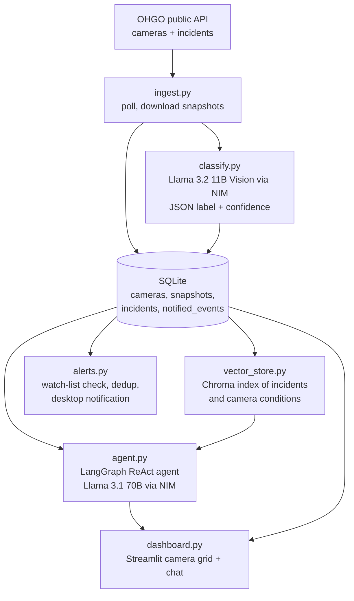

# OhioRoadWatch

An agent that watches live Ohio highway conditions. It pulls traffic-camera
snapshots and incidents from ODOT's official OHGO public API, labels each
snapshot with an open-weight vision-language model, indexes everything for
semantic search, and answers questions through a tool-calling LangGraph agent.
A separate checker sends a desktop alert when a watched route turns hazardous.

Everything runs locally on free tiers: the OHGO public API and NVIDIA NIM's
hosted inference for open models (Llama 3.2 11B Vision and Llama 3.1 70B).

## Architecture



`run_pipeline.py` runs ingest, index, and alerts on a fixed interval, and the
dashboard reads whatever the latest cycle produced.

## How the agent works

**Model.** `meta/llama-3.1-70b-instruct` through `ChatNVIDIA`, which supports
`bind_tools`, wrapped in LangGraph's `create_react_agent`. Temperature is 0
so answers stay consistent across runs.

**Tools.** The agent gets three tools and has to choose between exact lookup
and fuzzy search:

| Tool | Backed by | Used for |
|---|---|---|
| `list_cameras_near(location_query)` | SQLite text match | Resolving "Kent" or "I-76" to concrete camera ids |
| `get_camera_condition(camera_id)` | SQLite, latest snapshot | The current label, confidence, and note for one camera |
| `search_conditions(query)` | Chroma semantic search | Open questions like "snow near Akron" or "accidents on I-71" across incidents and conditions |

A typical answer chains them: find cameras near a place, read each camera's
latest condition, then search incidents on the same route.

**System prompt.** The agent is told to ground every answer in tool results
and to say plainly when data is stale or missing for the place asked about,
rather than guess.

**Retrieval.** Incidents and camera conditions are embedded into two Chroma
collections and searched together. Incidents that OHGO stops returning have
cleared, so they are removed from both SQLite and the index, which keeps the
agent from reporting a resolved crash as live.

**State and memory.** SQLite is the agent's long-term record: every snapshot
is kept with its timestamp, so conditions can be compared over time. Alert
deduplication lives in a `notified_events` table, so an ongoing snowstorm
alerts once when it starts, not on every poll, and alerts again only after it
clears and returns. Each chat question is answered independently, and the
agent does not carry conversation history between questions.

## Design decisions

- **Structured output from the vision model.** The classifier must return a
  JSON object with a label from a fixed set (`clear`, `wet`, `snow`, `ice`,
  `fog`, `heavy_traffic`, `incident`, `dark_low_visibility`, `unknown`), a
  confidence, and a short note. Code fences are stripped, and anything that
  still fails to parse becomes `unknown` with confidence 0 instead of
  crashing the pipeline.
- **Rate-limit pacing.** NIM's free tier shares about 40 requests per minute
  per key, so ingest spaces vision calls by `CLASSIFY_DELAY_SECONDS`
  (default 1.6s). A failed classification is logged and skipped.
- **Real API, not scraping.** Built against the documented OHGO Public API
  with pagination handled in `ohgo_client.py`.
- **Failure isolation.** One failed snapshot download, classification, or
  pipeline cycle is logged and the monitor keeps running.

## Running it

1. Get a free OHGO API key at https://publicapi.ohgo.com/accounts/registration
   and a free NVIDIA NIM key at https://build.nvidia.com.
2. Copy `.env.example` to `.env` and fill in both keys. Set `OHGO_REGION`
   (or `OHGO_RADIUS="lat,lon,miles"`) and the routes in `WATCH_ROUTES`.
3. Install:
   ```bash
   python -m venv venv && source venv/bin/activate   # venv\Scripts\activate on Windows
   pip install -r requirements.txt
   ```
4. Run one pipeline cycle to fill the database and index:
   ```bash
   python run_pipeline.py --once
   ```
5. Ask the agent from the command line, or open the dashboard:
   ```bash
   python agent.py
   streamlit run dashboard.py
   ```
6. To keep data fresh, leave `python run_pipeline.py` running in another
   terminal. It cycles every `POLL_INTERVAL_SECONDS` (default 300).

Desktop notifications use `plyer` and work out of the box on Windows and
macOS. On Linux they need `notify-send`. Every alert is also appended to
`data/alerts.log`.

## Project layout

| File | Purpose |
|---|---|
| `ohgo_client.py` | OHGO API client with pagination and APIKEY auth |
| `ingest.py` | Pulls cameras and incidents, downloads and classifies snapshots |
| `classify.py` | Vision-model call with a constrained JSON schema |
| `db.py` | SQLite schema and queries |
| `vector_store.py` | Chroma indexing and combined semantic search |
| `agent.py` | Tools, system prompt, and the LangGraph agent |
| `alerts.py` | Watch-list hazard check with deduplication |
| `dashboard.py` | Streamlit camera grid and chat |
| `run_pipeline.py` | Scheduled loop tying the pipeline together |

## Roadmap

- An evaluation set of labeled snapshots to measure classifier accuracy per
  label, plus a small set of question and expected-tool-call pairs to test
  the agent's tool selection.
- Conversation memory in the dashboard, so follow-ups like "what about
  eastbound?" resolve against the previous question.
- Distill the vision model's labels into a small CNN exported to ONNX, which
  would replace a per-image API call with local inference.
- Add OHGO's road weather sensor endpoint (surface temperature, visibility,
  precipitation) as another agent tool.
- Slack or email alerts in place of desktop notifications.

## Notes on the OHGO API

- Auth header: `Authorization: APIKEY <key>`.
- Regions: akron, cincinnati, cleveland, columbus, dayton, toledo,
  central-ohio, ne-ohio, nw-ohio, se-ohio, sw-ohio.
- Snapshots refresh roughly every 5 seconds on OHGO's side, so a 5-minute
  poll is plenty for a conditions monitor.
- Only live still snapshots are used, not recorded video.
